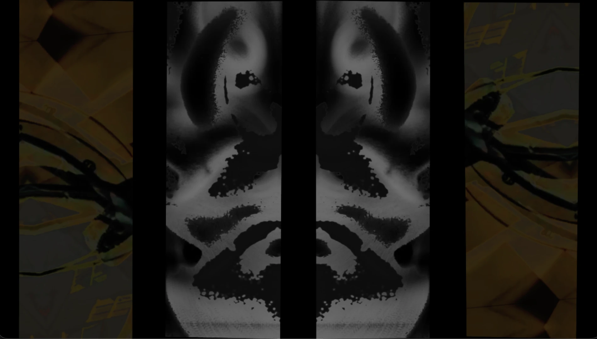
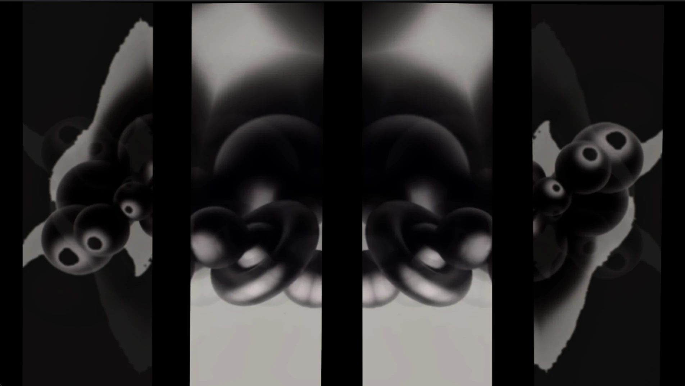

# studio visuals

Live visuals for a studio wall: four tall strips of paper, one projector, TouchDesigner.
Nobody VJs it. It picks the clips, the framing, the effects and the transitions on its own,
keeps the wall dark enough for a party, and follows the music when the beat tracker is on.





These are frames of what the projector gets, flat, before the paper.

## What it does

- The strips are two pairs: outer (1 and 4) and inner (2 and 3). Both pairs show the same
  clip but never the same way: each takes its own slice of the frame, one close and one wide,
  and runs its own effect chain. The two looks are never identical.
- A clip change is not a cut and not a crossfade. The inner pair goes first, as a tease, then
  the outer follows. Four transitions, drawn at random: a burn, a distortion, a colour arrival
  (red lands first, then green, then blue) and a feedback smear, each over 7 to 22 seconds.
- Every clip is measured once, offline, with ffmpeg. Bright clips get darkening effects
  (highlights cut, crush, edges, a self mask), dark ones get treatments (feedback, displace,
  echo, chroma). A limiter after each chain caps the mean brightness so the wall never lights
  the room, and two room sliders pull the whites down for the space.
- At every clip change each pair flips a coin per axis. On heads one strip of the pair turns,
  upside down or left for right, and the other stays, so the pair mirrors across the wall.
- Now and then a third clip drops in over one pair or both, swells in a few times, takes over
  for a while, and swells back out.
- A beat tracker runs beside TouchDesigner and sends beats over OSC. With it on, the slow
  drifts run at musical rates, the swells land every two bars, and the picture bounces a few
  percent on each beat. It hears the mic, or whatever the Mac is playing.

## How it is built

The `.toe` is a compressed binary nobody can read or diff, so **nothing in it was made by
hand**. Every change is a Python script in `td/`, run once from TouchDesigner's Textport, and
committed. `td/dump_network.py` writes the whole network back out as `td/network.json`, which
is what gets read and reviewed.

- `td/build_fx.py` builds `/project1/fx` from scratch: players, the two group chains, twelve
  effects each, the transitions, the spice, the limiter, the timers, the beat input.
- `td/sequencer.py` is the brain. It is synced into a Text DAT inside `fx`, so editing the
  file changes the running show. The decisions (which clip, which window, which effects,
  when) are pure Python with tests in `tests/`; the TouchDesigner calls are a thin layer.
- `td/glsl/` holds the transition shader and the room shader, also synced.
- `td/clip_stats.py` measures the clips into `td/clips.json`.
- `beat/beat_osc.py` is the tracker: madmom's beat network over a 30 second window, a comb
  filter for the tempo, the beats placed on it, sent as `/beat` to port 7400. It needs Python
  3.10, so it lives in its own environment under `beat/`.
- The four strips are mapped with Kantan Mapper from the TouchDesigner palette. The corner
  calibration for our wall is in the file; yours will differ.

`docs/tech/network.md` goes through the network operator by operator, and `docs/specs/` has
the two features as they were planned and built.

## Getting started

You need TouchDesigner 2025 (the free licence is fine; it caps textures at 1280 px, which the
strips are under), ffmpeg, Python 3, and for the tracker `uv` and Xcode's command line tools.
The tracker's system audio tap is macOS only; the rest runs wherever TouchDesigner does.

1. Clone the repo. Put your clips in `TD_Mapping/VJ_Visuals/` (any movie files; we keep clips
   over a minute in `Long/` inside it). The videos are not in git.
2. Measure them: `python3 td/clip_stats.py`. A clip missing from the table counts as bright.
3. Open `TD_Mapping/Studio_Up_new.toe`. The sequencer starts on its own. For a preview window
   on your screen, run the first line of the table below in the Textport (Alt+T).
4. Map the strips to your wall in Kantan Mapper (`/project1/kantanMapper1`), then save with
   the line in the table, not with TouchDesigner's Save, which writes a numbered copy.
5. Optional, the beat tracker: `bash beat/install.sh` once, then
   `beat/.venv/bin/python beat/beat_osc.py` for as long as the show runs, and `Beatsync` on.

The knobs are on `/project1/fx`: hover a parameter's name for what it does. `Darkness`,
`Roomdark` and `Roomcontrast` set the brightness for the room; the `Try` page steps through
effects and transitions by hand.

## Everyday commands

In the Textport, one line each as needed. `project.folder` is the folder the `.toe` is in,
so these work wherever the repo lives.

| what | line |
|---|---|
| preview window on this screen | `exec(open(project.folder + '/../td/open_output.py').read())` |
| preview full screen, mouse on the screen you want | `w = op('/project1/window'); w.par.borders = False; w.par.size = next(n for n in w.par.size.menuNames if 'fill' in n.lower()); w.par.winclose.pulse(); w.par.winopen.pulse()` |
| close the preview | `op('/project1/window').par.winclose.pulse()` |
| projector output, on the extended display | `op('/project1/kantanMapper1/project/window1').par.winopen.pulse()` |
| close it | `op('/project1/kantanMapper1/project/window1').par.winclose.pulse()` |
| strips solid, for lining up the paper | `for it in ('item5', 'item4', 'item2', 'item1'): op('/project1/kantanMapper1/project/allShapes/' + it + '/parameters').par.Showtexture = False` |
| video back on the strips | the same line with `True` |
| rebuild the chain after a script change | `exec(open(project.folder + '/../td/build_fx.py').read())` |
| restart the sequencer | `op('/project1/fx/sequencer').module.start()` |
| save | `project.save(project.folder + '/Studio_Up_new.toe')` |
| dump the network for git | `exec(open(project.folder + '/../td/dump_network.py').read())` |
| record five minutes | `exec(open(project.folder + '/../td/record.py').read())` |
| stop a recording early | `op('/project1/rec').par.record = 0; op('/project1/rec_cook').par.active = 0` |
| where the frame time goes | `exec(open(project.folder + '/../td/diag_cook.py').read())` |
| what the players are doing | `exec(open(project.folder + '/../td/diag_players.py').read())` |
| resolution at each step, file to screen | `exec(open(project.folder + '/../td/diag_res.py').read())` |

A recording is a Motion JPEG `.mov` in `TD_Mapping/Recordings/`; to send it:

    ffmpeg -i studio_<date>.mov -c:v libx264 -crf 20 -pix_fmt yuv420p studio_<date>.mp4

### The beat tracker

    bash beat/install.sh                      # once
    beat/.venv/bin/python beat/beat_osc.py    # for as long as the show runs

It prints a bpm every five seconds. On `fx`, `Beatsource` says what it hears: `mic` (the
Mac's default input, or `--device N` from `--list`) or `system`, everything the Mac plays, a
browser tab included; the first time `system` is picked, macOS asks once to allow system audio
recording for the terminal app. `--file song.wav` runs the same analysis over a recording, to
test it. Turn `Beatsync` on, watch `Bpm`, and tune `Beatoffset` until the bounce lands on the
beat. Ctrl-C stops it.

### The clips

`TD_Mapping/VJ_Visuals/` is what plays, `TD_Mapping/Not_Used/` is what does not. After adding
or removing clips:

    python3 td/clip_stats.py

To pick through them by eye, a page with three frames per clip:

    python3 td/curate.py
    python3 td/curate.py apply ~/Downloads/selection.json

### Tests

    python3 -m unittest discover tests

## Layout

```
TD_Mapping/   the .toe files (Studio_Up.toe is the original, untouched); the clips live here, out of git
td/           the scripts that build, run, read and diagnose the network, and its latest dump
beat/         the beat tracker and its install
tests/        the sequencer's pure logic and the clip measurement
docs/         setup, the network explained, decisions, the specs, the screenshots
.claude/      the Claude Code harness this was built with: commands, reviewer agents, commit hooks
```
